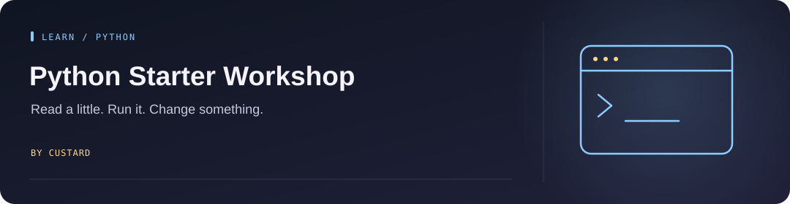

<!-- Project artwork created for this repository. -->
<p align="center">
  
</p>

<h1 align="center">Python Starter Workshop</h1>

<p align="center">
  
</p>

**Ten small lessons. Read the comments, run the code, and change something.**

<p align="center"><a href="#get-started">Get started</a> &nbsp; · &nbsp; <a href="#lesson-map">Lesson map</a></p>

## Get started

Install [Python 3](https://www.python.org/downloads/), download or clone this repository, and run a lesson from its root directory:

```bash
python 1_helloworld.py
```

Open the same file in your editor. The explanations and exercises live alongside the code.

## Lesson map

| Start with | Then explore |
| --- | --- |
| [Hello world](1_helloworld.py) | [Lists](6_lists.py) |
| [Variables](2_variables.py) | [Dictionaries](7_dictionaries.py) |
| [Types](3_types.py) | [Functions](8_functions.py) |
| [Input](4_inputs.py) | [Classes](9_classes.py) |
| [Control flow](5_control.py) | [Libraries](10_libraries.py) |

Work through the files in order or jump to a topic you want to practice. Run them locally so you can see how real Python files, imports, and terminal input fit together.

Adapted from the [USRC Python workshop](https://github.com/usydroboticsclub/python). The original teaching material and its authors retain their attribution.

See [source and rights](docs/SOURCE_AND_RIGHTS.md) before reusing imported exercises or media.
